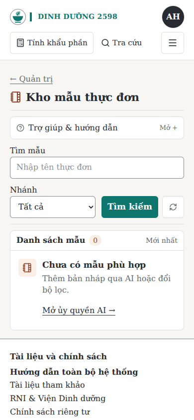
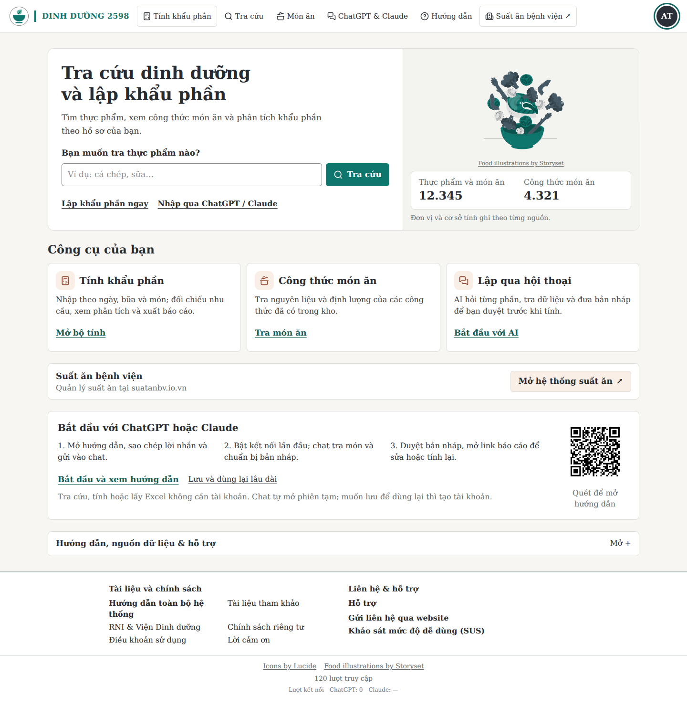

# Giảm phủ xanh và làm gọn kho mẫu — 21/10/2026

> Lưu trữ lịch sử: các lựa chọn và chỉ dẫn thiết kế trong tài liệu này đã được ngừng áp dụng ngày 23/10/2026. Nội dung được giữ để truy nguyên, không phải quy tắc thiết kế giao diện cho AI ở các lần làm tiếp.

Sau khi xem ảnh VPS, người dùng phản hồi giao diện quá nhiều xanh ngọc và chốt
hướng trắng ấm–xám than, xanh cho nhận diện/thao tác và cam đất nhấn nhẹ.
Bản này tiếp nối commit VPS `84dec6c`, chưa được đưa lên VPS.

## Thay đổi

- Nền `#F7F6F2`, chữ/tiêu đề `#272C33`, chữ phụ `#626A6A`, viền `#DEDEDA`.
  Giữ xanh ngọc `#0F766E` cho nhận diện, hành động và trạng thái chọn; cam đất
  `#B85B37`/nền `#FAEFE7` cho icon/nhãn đếm. Giữ Times New Roman/Times/serif.
- Menu và avatar chuyển sang trung tính. Các heading đang dùng chữ xanh trong
  class literal chuyển sang ink; màu lỗi/cảnh báo/trạng thái dinh dưỡng không đổi.
  Bảng và phần nhập liệu dùng nền đầu bảng xám thay cho xanh phủ toàn vùng.
- Bỏ dòng nhãn in hoa và các nút lớn khỏi đầu kho mẫu. Ủy quyền AI và tài liệu
  nằm trong thanh trợ giúp mở rộng; trạng thái rỗng vẫn có lối vào ủy quyền.
- Bộ lọc điện thoại còn hai hàng, nút làm mới có nhãn truy cập và Lucide
  RefreshCw. Giữ tìm/lọc phía máy chủ, phân trang, request sequence, xem mẫu,
  ngày/bữa/nhóm, null/0, clipboard và lịch sử như trước.
- Không đổi engine/API/quyền/schema/migration; không thêm npm dependency.

## Kiểm tra

| Phạm vi | Kết quả |
| --- | --- |
| Next build/TypeScript | Đạt; cache cục bộ cũ lỗi persistence đã chuyển ra ngoài và build sạch đạt |
| ESLint tệp sửa |0 lỗi,0 warning |
| Kho mẫu / giao diện bộ tính / link / tài khoản |153 /31 /27 /46 kiểm tra đạt |
| Chromium trang chủ/điều hướng |89 kiểm tra đạt ở1440/768/390/320px |
| Chromium bộ tính |32 kiểm tra đạt ở1440/768/390/320px, đổi100→150g cập nhật360→540kcal theo fixture |
| Chromium Admin |73 kiểm tra đạt ở1440/390px; cấp/thu hồi, lọc, preview, clipboard, tài liệu và role |
| Chromium RootLayout + kho mẫu |53 kiểm tra đạt ở1440/768/390/320px; rỗng/có mẫu, tìm/lọc/làm mới, mở trợ giúp |
| Next production HTTP cục bộ |21 kiểm tra đạt; CSS mới, manifest, SSR, chặn khách401/307 |

Browser dùng component thật và dữ liệu/API/phiên fixture, không phải phiên Admin
thật trên VPS. Không lỗi JS/tràn ngang toàn trang. Danh sách mẫu bắt đầu ở khoảng
463px tại390/320px,384px tại768px và332px tại1440px trong fixture có header đầy đủ.
Đã xem ảnh desktop/mobile, sửa tiêu đề và dòng trợ giúp xuống hàng tại320px.

Đối chiếu một số cặp màu: ink/trắng14,05:1; chữ phụ/trắng5,54:1, chữ phụ/nền5,13:1;
trắng/xanh5,47:1; chữ cam/nền cam5,92:1; viền ô nhập/trắng3,51:1. Đây là kiểm tra
các cặp token, không phải chứng nhận WCAG toàn website hoặc nghiên cứu tốc độ dùng.

## Ảnh xem trước

Ảnh Chromium với dữ liệu minh họa; chưa phải ảnh VPS của bản mới.

## Trạng thái VPS

Người dùng đã triển khai `84dec6c`, áp migration `20261021090000_admin_menu_library`,
app Healthy và health ok. Tám đường HTTPS công khai/khách đã được kiểm trực tiếp:
trang chủ, health, manifest, logo, xác minh Google, hai API Admin401 và trang
kho mẫu307. Nút Thông tin mới được bỏ theo yêu cầu; Caddy và tệp Google giữ cục bộ.

Đợt màu trung tính này không thêm migration. Chưa có truy cập SSH trong phiên này;
không ghi nhận rằng bản mới đã được triển khai hoặc kiểm phiên Admin thật.
